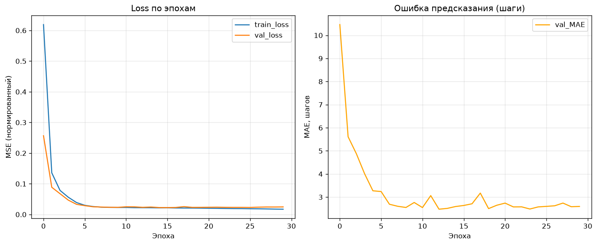
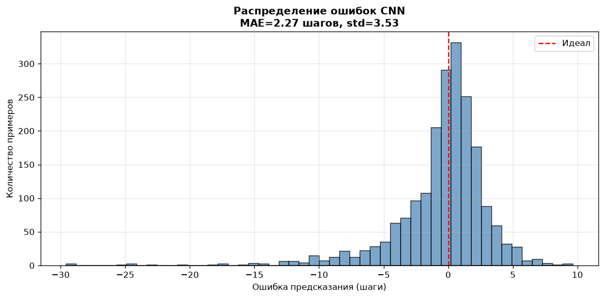
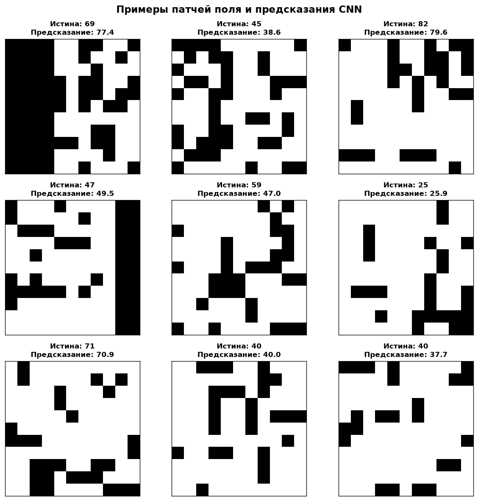
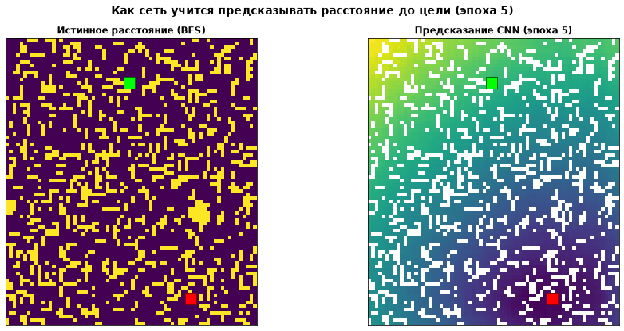
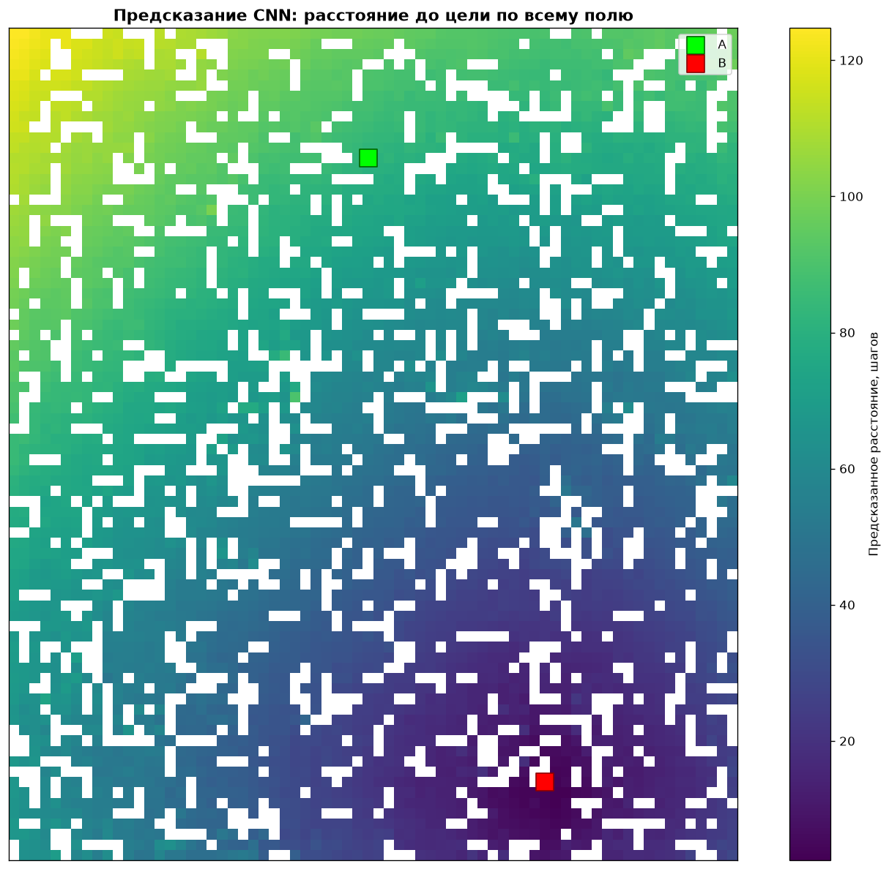
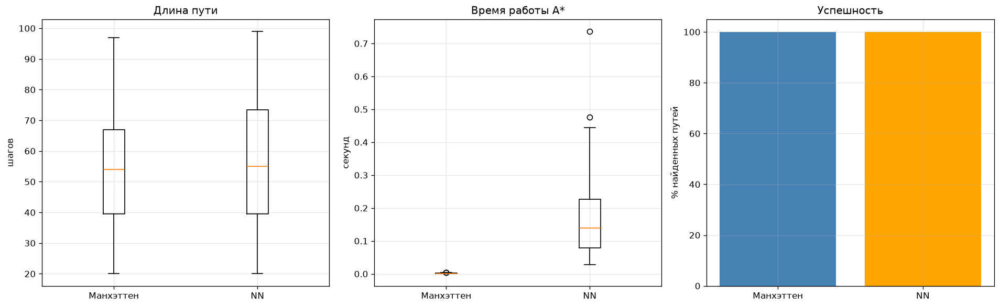
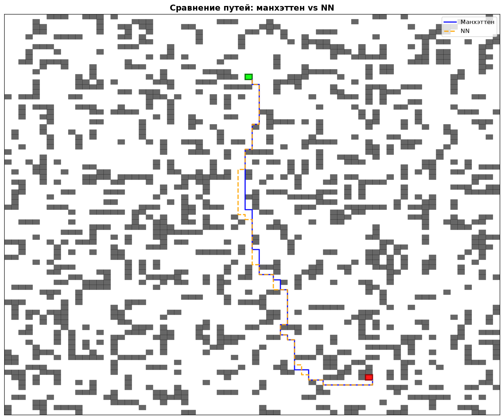
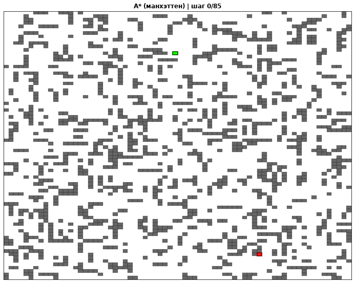
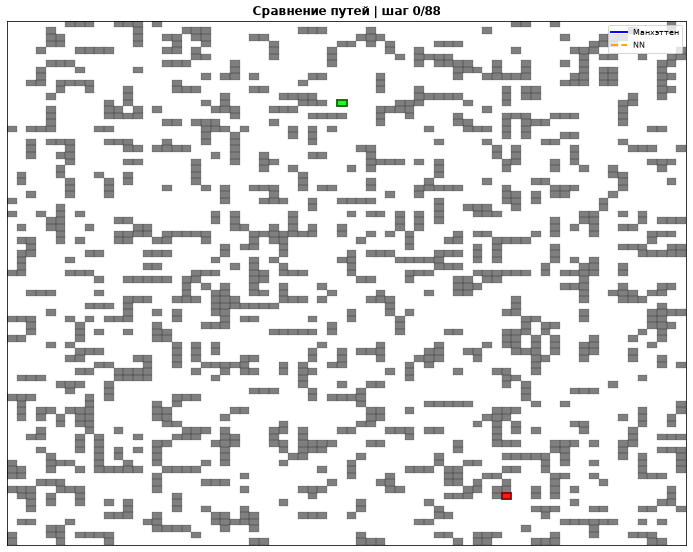
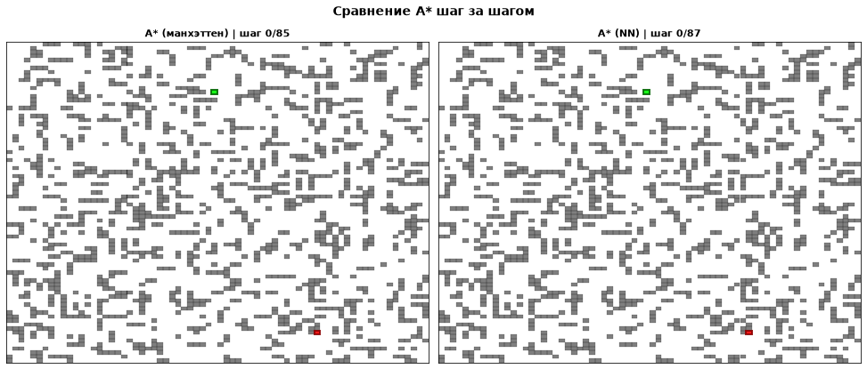

# 🧠 Нейросетевая эвристика для A* на сетке с препятствиями

[](https://www.python.org/)
[](https://pytorch.org/)
[](https://numpy.org/)
[](https://matplotlib.org/)
[](tests/)

> **Лабораторная работа №4** по курсу «Компьютерное моделирование»  
> МГТУ им. Н.Э. Баумана, кафедра СМ-6

---

## 📖 Оглавление

- [О проекте](#-о-проекте)
- [Как это работает](#-как-это-работает)
- [Результаты](#-результаты)
- [Архитектура](#-архитектура)
- [Установка и запуск](#-установка-и-запуск)
- [CLI-команды](#-cli-команды)
- [Тестирование](#-тестирование)
- [Лицензия](#-лицензия)

---

## 🎯 О проекте

Сравнение классической эвристики (манхэттенское расстояние) и обученной свёрточной нейросети в алгоритме A* для поиска пути на сетке с препятствиями.

**Идея:** вместо ручной эвристики `h = |x - goal_x| + |y - goal_y|` используем CNN, которая по локальному патчу поля и смещению до цели предсказывает истинное расстояние до цели. Сеть обучается на разметке, полученной BFS.

**Что исследуется:**
- может ли нейросеть заменить ручную эвристику;
- как меняется длина пути и время работы A*;
- насколько точно CNN предсказывает расстояние.

---

## 🧩 Как это работает

1. Генерируем поля `80×70` с препятствиями и точками A/B.
2. Для каждого поля запускаем BFS от цели — получаем точное расстояние до цели для каждой свободной клетки.
3. Нарезаем патчи `11×11` вокруг клеток и добавляем смещение до цели → датасет `(патч, offset, расстояние)`.
4. Обучаем CNN регрессии: `(патч, offset) → расстояние`.
5. Встраиваем сеть в A* как эвристику.
6. Сравниваем с манхэттенской эвристикой по длине пути, времени и успешности.

---

## 📊 Результаты

### Графики обучения







### Как сеть учится



### Heatmap предсказаний CNN



### Сравнение A* с манхэттеном и NN





### Анимации

**A* шаг за шагом:**



**Сравнение путей одновременно:**



**Два A* шаг за шагом:**



### Пример поля


---

## 📈 Ключевые метрики

| Метрика | Манхэттен | NN |
|---------|-----------|-----|
| Средняя длина пути | 56.04 | 57.08 |
| Среднее время A* | 0.0015 с | 0.176 с |
| Успешность | 100% | 100% |
| MAE предсказания | — | **2.59 шагов** |

**Вывод:** нейросеть обучилась предсказывать расстояние с точностью ±2.5 шага. A* с NN находит путь почти такой же длины, но работает медленнее из-за инференса CNN на CPU. Эвристика NN недопустима (может переоценивать), поэтому A* иногда находит чуть более длинный путь — это честный результат.

---

## 🏗 Архитектура

```text
LR4 KM/
├── src/
│   ├── grid.py          # генерация поля и точек A/B
│   ├── heuristics.py    # манхэттенская эвристика
│   ├── astar.py         # A*
│   ├── bfs.py           # BFS-разметка расстояний
│   ├── dataset.py       # сбор датасета
│   ├── model.py         # CNN на PyTorch
│   ├── train.py         # обучение
│   ├── astar_nn.py      # A* с нейросетевой эвристикой
│   ├── compare.py       # сравнение двух эвристик
│   ├── visualize.py     # графики и карты
│   ├── cli.py           # CLI
│   └── main.py          # точка входа
├── tests/
├── data/
├── models/
└── results/


---

## 🚀 Установка и запуск

```powershell
python -m venv .venv
.venv\Scripts\Activate.ps1
pip install -r requirements.txt

# 1. Сгенерировать датасет
python -m src.main generate-data --n-maps 300 --samples-per-map 100

# 2. Обучить модель
python -m src.main train --epochs 30

# 3. Запустить A* с манхэттенской эвристикой
python -m src.main run-astar --seed 42

# 4. Запустить A* с нейросетевой эвристикой
python -m src.main run-astar-nn --seed 42

# 5. Сравнить на 50 полях
python -m src.main compare --n-maps 50

# 6. Нарисовать два пути на одном поле
python -m src.main compare-two-paths --seed 42

# 7. Построить графики обучения
python -m src.main plot-errors
python -m src.main plot-patches
python -m src.main plot-heatmap

# 8. Создать гифки
python -m src.main animate-astar --seed 42
python -m src.main animate-comparison --seed 42
python -m src.main animate-astar-nn --seed 42
python -m src.main animate-learning

## 🧪 Тестирование

python -m pytest tests/ -v

Все 16 тестов проходят.

---

## 📚 CLI-команды

| Команда | Описание |
|---------|----------|
| generate-data | Сгенерировать датасет |
| train | Обучить CNN-эвристику |
| run-astar | A* с манхэттенской эвристикой |
| run-astar-nn | A* с нейросетевой эвристикой |
| compare | Сравнить две эвристики на N полях |
| compare-two-paths | Два пути на одном поле |
| plot-errors | Гистограмма ошибок CNN |
| plot-patches | Примеры патчей и предсказаний |
| plot-heatmap | Heatmap предсказаний CNN |
| animate-astar | GIF: A* шаг за шагом |
| animate-comparison | GIF: два пути одновременно |
| animate-astar-nn | GIF: два A* шаг за шагом |
| animate-learning | GIF: как сеть учится |

---

## 📄 Лицензия

MIT License — для образовательных и исследовательских целей.